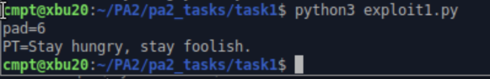

# CBC padding-oracle decryption and ciphertext construction

**Source:** Programming Assignment 2, Tasks 1.1–1.3. **Status:** three recorded VM runs and a separate construction readback.

I used supplied local oracle programs that distinguished accepted padding from a padding error. The scripts manipulated the block preceding the target block and used each response to recover the needed bytes.

| Task | Work | Recorded validation |
| --- | --- | --- |
| 1.1 | Decrypted a short ciphertext by recovering blocks from the end and accounting for the existing final padding. | The Xubuntu run printed `pad=6` and the expected short plaintext. |
| 1.2 | Applied the same block recovery to a longer ciphertext. | The report records successful completion and a terminal capture of the two-line output, with the longer plaintext wrapping visually. |
| 1.3 | Worked backward from a selected final ciphertext block to construct earlier blocks for a chosen message. | The program emitted a ciphertext. A separate call to the supplied oracle accepted it and printed the target plaintext. |

## Original short-message evidence

This original screenshot contains no reconstructed output. The longer test and construction validation are described from the source report, rather than represented as fresh runs in this repository.

## Implementation detail

For decryption, the scripts adjust already recovered suffix bytes to the next padding value, try a candidate at the preceding position, and combine the accepted candidate with the original preceding block and padding value. The one-byte case includes a check to avoid mistaking existing longer padding for the requested one-byte padding.

For construction, the script recovers an intermediate block and XORs it with the desired plaintext block to obtain the preceding ciphertext block. Repeating that operation backward produces the IV and ciphertext sequence.

## Limits

The programs are tied to the course oracle's output strings and use one subprocess query at a time. They are not a network attack tool or a general benchmark. The supplied Linux executables are not redistributed. The public construction script accepts its final block as an argument so it does not embed the student-number-derived value from the submission.

The construction loop is preserved and does not add the extra one-byte ambiguity check used in the decryption helper. The report's successful fixed-case run does not establish correctness for all possible inputs or oracle variants.

**Skills demonstrated:** CBC reasoning, PKCS#7 handling, byte manipulation, subprocess integration, and independent validation of generated output.
